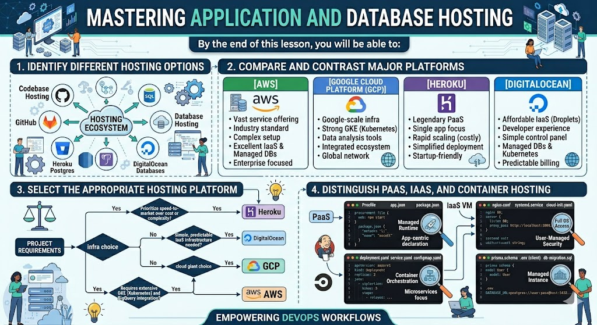

# [4.10] Hosting Options - Manual Hosting

## Lesson Overview

## Dependencies
- [Self Studies](./studies.md)
- [Lesson](./lesson.md)
- [Assignment](./assignment.md)

## Lesson Objectives
* **Identify** different hosting options for both codebase and database
* **Compare** and contrast different hosting platforms
* **Select** the appropriate hosting platform based on project requirements
* **Distinguish** between PaaS, IaaS, and container hosting
* **Deploy** a containerized application and a PostgreSQL database to Railway, starting from a Docker Hub image

## Lesson Plan

| Duration | What | How or Why |
|----------|------|------------|
| 10 min | Warm up | Intro and lesson overview, recap containerization and Docker Hub |
| 20 min | Part 1: Understanding application hosting | What hosting is, types of hosting — PaaS, IaaS, container hosting |
| 30 min | Part 2: Comparing hosting platforms | Railway, Render, Fly.io, Heroku — pros, cons, free tiers, comparison table |
| 10 min | Activity 1 — Platform matching discussion | Learners match platforms to scenarios based on Part 2 comparisons |
| 35 min | Part 3: Deploy devops-demo to Railway (hands-on) | Learners build and push devops-demo `v4.6.3` (PostgreSQL version) to Docker Hub, deploy it to Railway from the image, generate a domain and read the logs (expected crash - no database yet); Lesson 4.12 deploys from GitHub instead |
| 25 min | Part 4: Hosting databases (hands-on) | Database hosting options; learners add PostgreSQL on Railway, connect devops-demo with reference variables, redeploy and test `/hello` |
| 25 min | Part 5: Platform selection activity | Small groups work through 4 hosting scenario cards and justify platform choices |
| 10 min | Part 6: Deployment best practices | Environment variables, health checks, logging, resource limits, common issues |
| 10 min | Recap and wrap up | Key takeaways, preview Lesson 4.12 (deploy from GitHub, automated deployment), Q&A |
| **Total** | | **175 min — allows ~5 min buffer** |